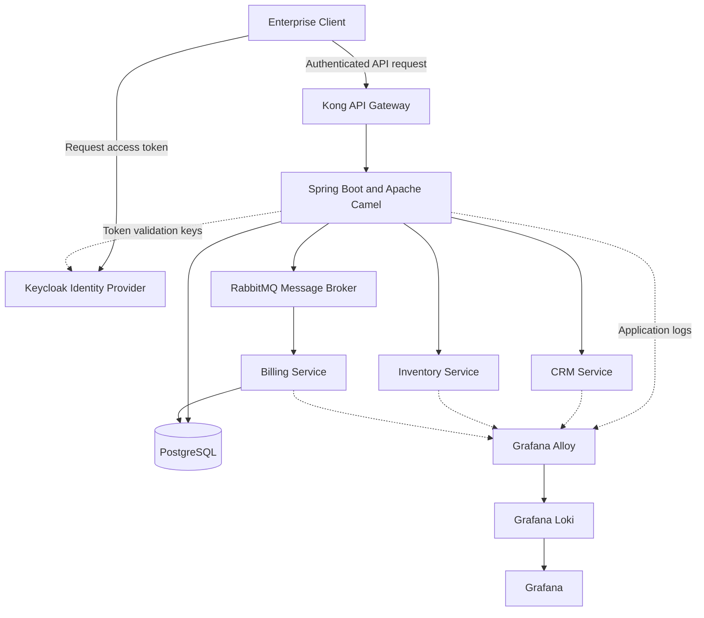

# ConnectBridge

## Secure Enterprise Middleware and API Integration Platform

**Project Status:** In Development

## Overview

ConnectBridge is a locally hosted enterprise middleware and API integration platform designed to enable secure, reliable and observable communication between independent business systems.

The project simulates an enterprise environment where Customer Relationship Management (CRM), Inventory and Billing systems communicate through a centralized integration layer.

ConnectBridge aims to address common enterprise integration challenges, including incompatible data formats, authentication, service availability, asynchronous communication, error handling and operational visibility.

## Project Objectives

- Implement enterprise middleware using Java, Spring Boot and Apache Camel.
- Enable secure communication between independent business applications.
- Implement centralized authentication and authorization.
- Support synchronous and asynchronous communication.
- Implement message transformation, validation and routing.
- Automate infrastructure provisioning and configuration.
- Deploy containerized applications to a local Kubernetes cluster.
- Implement vulnerability scanning and infrastructure security controls.
- Establish centralized logging and operational visibility.
- Validate system reliability through automated testing and failure simulations.

## Business Use Case

ConnectBridge simulates an enterprise order processing workflow involving three independent business systems:

- CRM: Customer information and validation.
- Inventory: Product availability and stock management.
- Billing: Invoice generation and billing transactions.

The middleware coordinates communication between these systems while providing centralized security, data transformation, message routing and error handling.

## Proposed Architecture



## Technology Stack

| Category | Technology |
|---|---|
| Programming Language | Java 21 |
| Application Framework | Spring Boot |
| Enterprise Middleware | Apache Camel |
| API Gateway | Kong |
| Identity Management | Keycloak |
| Message Broker | RabbitMQ |
| Database | PostgreSQL |
| Containerization | Docker |
| Local Development | Docker Compose |
| Container Orchestration | Kubernetes |
| Local Kubernetes | Kind |
| Infrastructure as Code | Terraform |
| Configuration Management | Ansible |
| Package Management | Helm |
| Security Scanning | Trivy |
| Log Collection | Grafana Alloy |
| Centralized Logging | Grafana Loki |
| Visualization | Grafana |
| Build Management | Maven |
| Continuous Integration | GitHub Actions |
| Version Control | Git and GitHub |

## Project Structure

```text
connectbridge/
├── .github/workflows/
├── infrastructure/
│   ├── terraform/
│   ├── ansible/
│   └── kind/
├── services/
│   ├── middleware/
│   ├── crm/
│   ├── inventory/
│   └── billing/
├── gateway/kong/
├── identity/keycloak/
├── messaging/rabbitmq/
├── database/postgresql/
├── observability/
│   ├── alloy/
│   ├── loki/
│   └── grafana/
├── deployment/
│   ├── docker/
│   └── helm/
├── security/trivy/
├── tests/
│   ├── integration/
│   ├── security/
│   ├── reliability/
│   └── uat/
├── docs/
├── .gitignore
├── LICENSE
└── README.md
```

## Development Environment

The project is designed to run on local infrastructure without requiring a public cloud provider.

| Component | Verified Local Version |
|---|---|
| Operating System | Ubuntu 26.04.1 LTS |
| Docker Engine | 29.10.1 |
| Docker Compose | 5.8.0 |
| Docker Buildx | 0.39.1 |
| Terraform | 1.17.2 |
| Ansible Core | 2.20.1 |
| kubectl | 1.37.3 |
| Kind | 0.33.0 |
| Helm | 4.3.2 |
| Trivy | 0.76.2 |
| OpenJDK | 21.0.13.1 |
| Maven | 3.9.12 |

Application dependencies, container images and Kubernetes cluster versions will be selected and pinned during implementation.

## Implementation Roadmap

- [x] Local infrastructure preparation
- [x] GitHub repository initialization
- [x] Infrastructure tool installation
- [x] Project directory structure
- [x] Git exclusion configuration
- [ ] Requirements and architecture documentation
- [ ] Terraform infrastructure provisioning
- [ ] Ansible configuration automation
- [ ] Local Kubernetes cluster deployment
- [ ] Spring Boot application development
- [ ] Apache Camel middleware implementation
- [ ] RabbitMQ messaging integration
- [ ] Keycloak authentication and authorization
- [ ] Kong API Gateway integration
- [ ] Helm application deployment
- [ ] Trivy security scanning
- [ ] Grafana Alloy and Loki integration
- [ ] Grafana operational dashboards
- [ ] GitHub Actions CI pipeline
- [ ] Integration and security testing
- [ ] Reliability and failure recovery testing
- [ ] User acceptance testing
- [ ] Final documentation and release

## Security Principles

ConnectBridge will follow the following security principles:

- Least-privilege access.
- Authentication and role-based authorization.
- Secure handling of application credentials.
- Input validation and controlled error responses.
- Container image and configuration scanning.
- Network isolation where supported.
- Protection of sensitive information in application logs.
- Secure software dependency management.

## Reliability Principles

The platform will implement and evaluate:

- Health checks and readiness probes.
- Controlled retry mechanisms.
- Dead-letter queues.
- Idempotent transaction processing.
- Structured logging and correlation identifiers.
- Graceful failure handling.
- Persistent transaction storage.
- Backup and recovery procedures.
- Deployment rollback procedures.

## Documentation

Project documentation will cover:

- Functional requirements.
- Non-functional requirements.
- System architecture.
- Infrastructure provisioning.
- Deployment procedures.
- API documentation.
- Security controls.
- Troubleshooting and operational runbooks.
- Integration and reliability testing.
- User acceptance testing.

## Project Scope

ConnectBridge is a hands-on enterprise integration and infrastructure engineering project.

The CRM, Inventory and Billing services represent simulated enterprise applications. The platform is intended for local development, experimentation, testing and demonstration rather than production processing of real customer data.

## Author

Temitope Komolafe

GitHub: https://github.com/komolafetemitope14

Portfolio: https://komolafetemitope14.github.io/portfolio/

## License

See the LICENSE file for licensing information.
