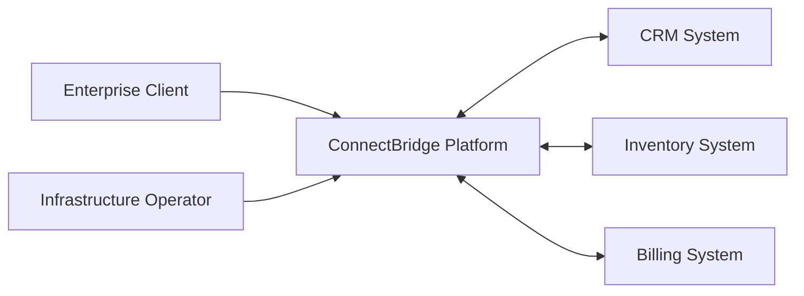
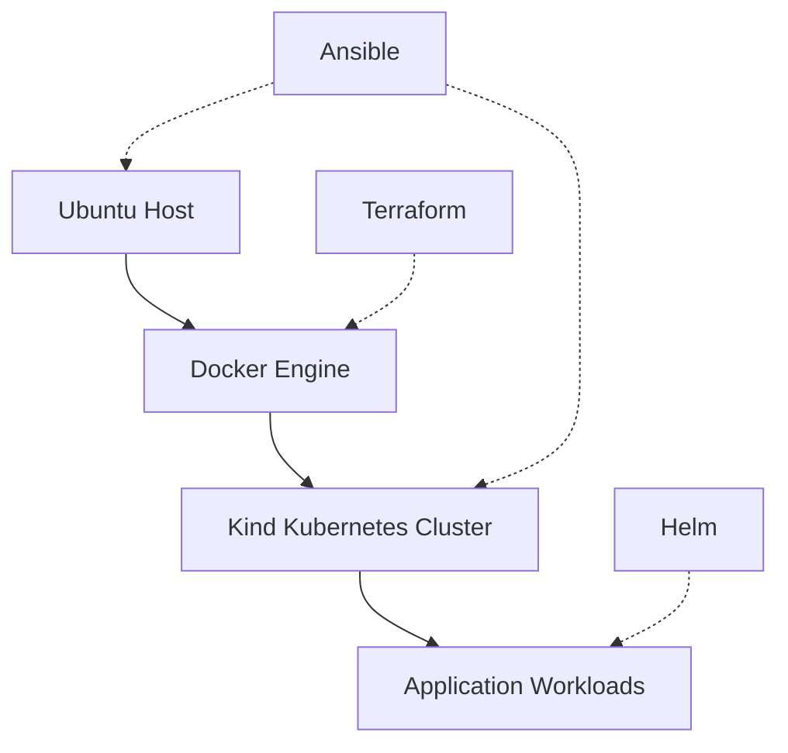
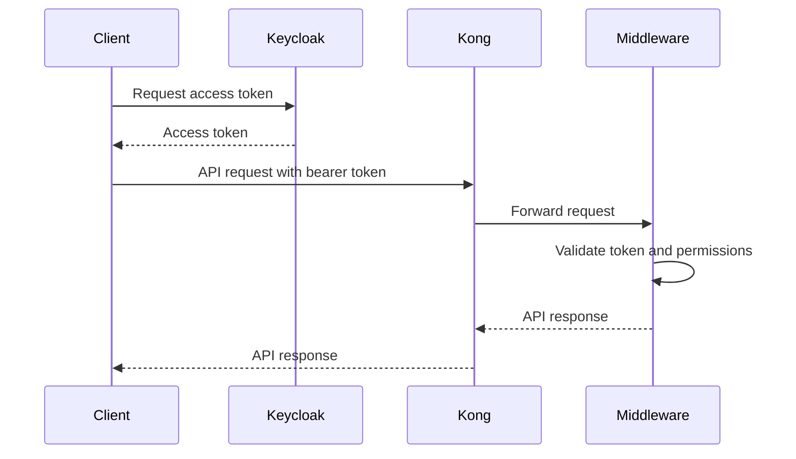
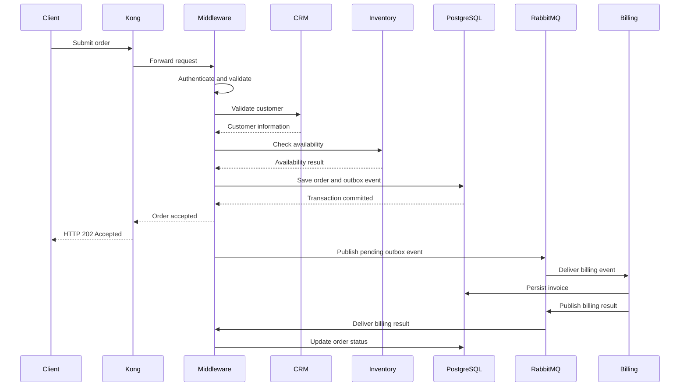
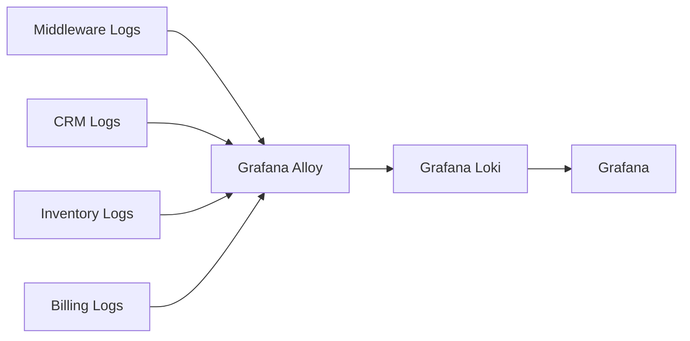

# ConnectBridge - System Architecture

## 1. Architecture Overview

ConnectBridge is a locally hosted enterprise middleware and API integration platform designed to provide secure, reliable and observable communication between independent business applications.

The platform adopts a layered, containerized and service-oriented architecture.

This document describes the proposed architecture. Implementation details will be refined and validated throughout development.

## 2. Architecture Objectives

- Reduce coupling between enterprise applications.
- Centralize integration and message transformation.
- Enforce authentication and authorization.
- Support synchronous and asynchronous communication.
- Improve transaction reliability and recoverability.
- Provide centralized operational visibility.
- Enable reproducible infrastructure and deployments.
- Maintain compatibility with local hardware constraints.

## 3. System Context

## 4. Component Architecture

| Component | Technology | Responsibility |
|---|---|---|
| API Gateway | Kong | Request routing and rate limiting |
| Identity Provider | Keycloak | Token issuance and identity management |
| Middleware | Spring Boot and Apache Camel | Validation, transformation and integration |
| Message Broker | RabbitMQ | Asynchronous messaging and message delivery |
| CRM Service | Spring Boot | Simulated customer information |
| Inventory Service | Spring Boot | Simulated product availability |
| Billing Service | Spring Boot | Simulated invoice generation |
| Database | PostgreSQL | Persistent application data |
| Log Collector | Grafana Alloy | Log collection and forwarding |
| Log Storage | Grafana Loki | Centralized log aggregation |
| Visualization | Grafana | Operational log exploration |
| Infrastructure | Terraform | Declarative infrastructure provisioning |
| Configuration | Ansible | Repeatable configuration automation |
| Orchestration | Kind and Kubernetes | Local container orchestration |
| Deployment | Helm | Kubernetes application packaging |
| Security | Trivy | Vulnerability and configuration scanning |

## 5. Infrastructure Architecture

The platform shall operate on a local Ubuntu host.

Docker Engine provides the container runtime environment used by Kind to create Kubernetes nodes.

Terraform shall manage selected local infrastructure resources.

Ansible shall automate repeatable host and environment configuration tasks.

Kind shall provide the local Kubernetes cluster.

Helm shall manage application deployments within Kubernetes.

Infrastructure resources shall have clearly defined ownership to avoid multiple tools managing the same resource.

## 6. Kubernetes Namespace Design

| Namespace | Responsibility |
|---|---|
| connectbridge-app | Middleware and simulated business services |
| connectbridge-gateway | Kong API Gateway |
| connectbridge-identity | Keycloak identity provider |
| connectbridge-messaging | RabbitMQ message broker |
| connectbridge-data | PostgreSQL database |
| connectbridge-observability | Alloy, Loki and Grafana |

Namespace separation provides logical organization.

Network isolation requires additional controls and a network implementation that supports policy enforcement.

## 7. Authentication and Authorization

Keycloak shall issue OAuth 2.0 access tokens.

Enterprise clients shall obtain tokens before accessing protected APIs.

Kong shall route requests to the middleware.

The middleware shall validate access token signatures, issuer, audience and expiration.

Role-based authorization shall restrict protected operations.

The initial implementation shall support:

- Service-to-service authentication.
- Client credentials flow.
- Role-based API access.
- Token expiration validation.
- Unauthorized request rejection.

## 8. Enterprise Order Processing

The order submission response confirms acceptance rather than completion of billing.

Clients shall retrieve the final transaction status through a separate API endpoint.

The initial inventory operation validates availability but does not guarantee stock reservation.

## 9. Data Transformation

Apache Camel shall provide message transformation and routing capabilities.

The middleware shall support:

- JSON payload validation.
- XML payload validation.
- JSON-to-XML transformation.
- XML-to-JSON transformation.
- Internal canonical data models.
- Content-based routing.
- Message enrichment.
- Controlled error handling.

Business services shall not need to understand every external message format.

## 10. API Design

The initial proposed API endpoints are:

| Method | Endpoint | Purpose |
|---|---|---|
| POST | /api/v1/orders | Submit an order |
| GET | /api/v1/orders/{orderId} | Retrieve order status |
| GET | /actuator/health | Internal application health |
| GET | /actuator/health/readiness | Internal readiness status |

Administrative replay operations shall be designed separately and protected by appropriate authorization.

Management endpoints shall not be unnecessarily exposed through the public gateway.

## 11. Database Architecture

PostgreSQL shall provide persistent application storage.

The initial logical data entities are:

| Entity | Responsibility |
|---|---|
| Customers | Simulated customer records |
| Products | Simulated product information |
| Orders | Order transaction records |
| Order Items | Individual order items |
| Invoices | Billing transaction records |
| Outbox Events | Events awaiting reliable publication |
| Processed Messages | Duplicate message detection |
| Audit Events | Security and administrative records |

Each business service shall own its logical data.

The initial deployment may use one PostgreSQL instance with separate logical databases or schemas and restricted service accounts.

Services shall not directly modify data owned by another service.

Database schema migrations shall be version-controlled.

## 12. Messaging Architecture

RabbitMQ shall provide asynchronous communication between the middleware and Billing service.

Proposed messaging resources:

| Resource | Name |
|---|---|
| Exchange | connectbridge.events |
| Billing request queue | billing.requests |
| Billing result queue | billing.results |
| Retry queue | billing.requests.retry |
| Dead-letter exchange | connectbridge.dlx |
| Dead-letter queue | billing.requests.dlq |

Messages shall contain:

- Unique event identifier.
- Correlation identifier.
- Event type.
- Event timestamp.
- Schema version.
- Business transaction identifier.
- Event payload.

The platform shall assume at-least-once message delivery.

Consumers shall implement idempotent processing.

Publisher confirmations and appropriate consumer acknowledgements shall be used.

## 13. Transaction Reliability

The platform shall evaluate the transactional outbox pattern to reduce inconsistencies between database transactions and message publication.

The order and its pending event shall be stored within the same database transaction.

A publisher shall deliver pending events to RabbitMQ.

Duplicate publication may occur during recovery.

Consumers shall therefore detect previously processed events.

Invoice creation shall be protected using database uniqueness constraints and idempotent processing.

## 14. Error Handling

| Failure Scenario | Proposed Handling |
|---|---|
| Invalid request | Reject with structured validation response |
| Invalid access token | Reject with HTTP 401 |
| Insufficient permissions | Reject with HTTP 403 |
| Duplicate request | Return existing transaction where appropriate |
| Conflicting idempotency key | Reject with HTTP 409 |
| Insufficient inventory | Reject with business error |
| CRM unavailable | Apply timeout and controlled retry |
| Inventory unavailable | Apply timeout and controlled retry |
| Database unavailable | Reject or defer operation safely |
| RabbitMQ unavailable | Retain pending outbox events |
| Billing failure | Apply bounded retry |
| Retry exhaustion | Route message to dead-letter queue |

Automatic retries shall be limited to appropriate transient failures.

Permanent validation failures shall not be retried unnecessarily.

## 15. Observability Architecture

Grafana Alloy shall collect application container logs and forward them to Loki.

Grafana shall provide centralized log exploration.

Structured logs should include:

- Timestamp.
- Service name.
- Log level.
- Correlation identifier.
- Transaction identifier.
- Event type.
- Processing outcome.
- Error classification where applicable.

Access tokens, passwords and sensitive payloads shall not be logged.

High-cardinality identifiers shall be stored in log content rather than Loki index labels.

## 16. Security Architecture

The platform shall implement:

- OAuth 2.0 authentication.
- Role-based authorization.
- Restricted service accounts.
- Secret management.
- Input validation.
- Container image scanning.
- Infrastructure configuration scanning.
- Controlled service exposure.
- Secure logging.
- Dependency version management.

Trivy shall be integrated into the development and CI workflow.

Local HTTP access may be used during isolated development.

TLS requirements shall be evaluated before any external exposure.

## 17. Deployment Strategy

The platform shall be implemented incrementally.

Stage 1:
- Infrastructure provisioning.
- Environment configuration.
- Local Kubernetes cluster.

Stage 2:
- Middleware development.
- Simulated business services.
- PostgreSQL integration.

Stage 3:
- RabbitMQ integration.
- Keycloak authentication.
- Kong API Gateway.

Stage 4:
- Helm deployment.
- Centralized logging.
- Security scanning.

Stage 5:
- Automated testing.
- Failure simulations.
- Recovery exercises.
- User acceptance testing.

## 18. Resource Management

The local environment has limited physical resources.

The initial cluster shall use a lightweight topology.

Application CPU and memory requests and limits shall be introduced and measured during deployment.

Services shall be deployed incrementally to avoid unnecessary resource exhaustion.

Existing host databases and unrelated applications shall remain isolated from ConnectBridge resources.

## 19. Architecture Constraints

- No mandatory public cloud infrastructure.
- No production customer information.
- Simulated enterprise business services.
- Local hardware capacity limitations.
- No claim of production-grade high availability.
- External dependencies must be version-pinned.
- Security and reliability controls must be validated.

## 20. Architecture Validation

The architecture shall be evaluated through:

- Functional requirement testing.
- API integration testing.
- Authentication and authorization testing.
- Message delivery testing.
- Duplicate transaction testing.
- Infrastructure failure simulations.
- Backup and recovery testing.
- Deployment rollback testing.
- Resource utilization measurements.
- User acceptance testing.
